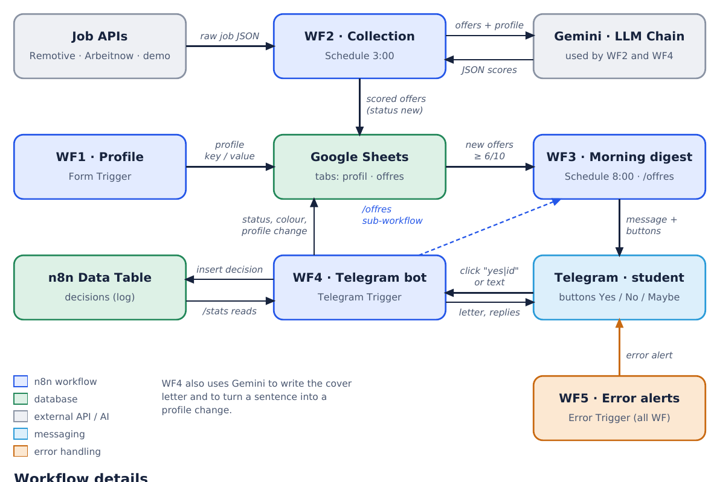

# 📡 Radar Carrière

**AI internship radar on Telegram, built with n8n.**
Every night, Radar Carrière collects job and internship offers from APIs, has an AI (Gemini) score each one against the student's profile, and every morning sends the best ones on Telegram. The student decides in one tap (✅ Yes / ❌ No / 🟠 Maybe); on “Yes”, the AI writes a tailored cover letter. Nothing is ever sent to an employer without the student's approval.



Full scoping deliverable (need, triggers, diagram, level and cut line, requirements): [`docs/scoping-deliverable.pdf`](docs/scoping-deliverable.pdf)

---

## Workflows

| File | Trigger | Role |
|---|---|---|
| `workflows/WF1 - Profil.json` | Form Trigger | Student profile form → Google Sheets (`profil` tab, key/value) |
| `workflows/WF2- Collecte.json` | Schedule 03:00 + manual | Remotive + Arbeitnow APIs (+ demo offers in manual runs) → normalize → dedupe → Gemini scoring (one batched call, JSON validated) → Google Sheets (`offres` tab) |
| `workflows/WF3 - Digest Telegram.json` | Schedule 08:00 + manual + sub-workflow | Best new offers (score ≥ 6, sorted by deadline, max 5) → Telegram messages with inline buttons |
| `workflows/WF4 - Boutons Telegram.json` | Telegram Trigger | Bot: commands, button clicks, profile changes in plain language, cover letters, decision log (n8n Data Table `decisions`) |
| `workflows/WF5 - Alertes erreurs.json` | Error Trigger | Error workflow of WF1–WF4: Telegram alert with workflow name, node, error and execution URL |

## Minimum technical requirements

| Requirement | Where |
|---|---|
| If / Set | `Offre valide ?` (WF2), `Offre à envoyer ?` (WF3), `Modification comprise ?`, `Ma candidature` (WF4) |
| Code | Normalization, deduplication, sorting, AI output validation, Telegram update parsing |
| Switch | `Clic ou message ?` (3 routes), `Quelle commande ?` (10 routes) in WF4 |
| API | Remotive & Arbeitnow (HTTP Request), Google Sheets API, Telegram Bot API, Gemini |
| Message trigger | Telegram Trigger (WF4) |
| Database | n8n Data Table `decisions` (insert on every click, read back by `/stats`); Google Sheets as the shared business table |
| AI node | Basic LLM Chain + Gemini, with a written system prompt (scoring, cover letter, profile changes) |
| Sub-workflow | WF4 → `Lancer le digest` → WF3 with defined inputs `chat_id`, `origine` |
| Error handling & retries | Retry On Fail (max tries + wait) on every external call; failing sources do not stop the others; invalid AI answer → status `erreur IA`; WF5 error workflow; `/panne` triggers a failure on demand |

---

## Setup: from clone to running

The project runs on **n8n Cloud** (the Telegram Trigger needs a public HTTPS URL, which n8n Cloud provides).

### Prerequisites
- An n8n instance (n8n Cloud)
- A Telegram bot token (create one with [@BotFather](https://t.me/BotFather))
- A Google account (Google Sheets) and a Gemini API key ([Google AI Studio](https://aistudio.google.com/apikey))

### 1. Clone
```bash
git clone <repo-url> radar-carriere
```

### 2. Import the workflows
In n8n: **Create workflow → ⋯ → Import from file**, once for each file in `workflows/`.

### 3. Create the credentials (in the n8n UI, never in the repo)
- **Google Sheets OAuth2**: sheet *Radar Carrière* with tabs `profil` (columns `cle`, `valeur`) and `offres` (columns `id, titre, entreprise , lieu, pays, remote, type_contrat, durée, salaire, deadline, url, source, description, score, resume, raison, statut, date_ajout, date_decision`)
- **Telegram API**: bot token
- **Google Gemini (PaLM) API**: API key
- Create the n8n Data Table **`decisions`** with columns `offre_id` (string), `titre` (string), `entreprise` (string), `decision` (string), `score` (number)

Assign the credentials in each workflow, set **WF5** as the error workflow of WF1–WF4 (Workflow settings → Error workflow), then publish WF1–WF5.

### 4. Connect Telegram
Send `/start` to the bot: it stores your `chat_id` and replies “✅ C'est bon, ton radar est connecté !”.

---

## Self-hosting with Docker

`docker-compose.yml` runs n8n with PostgreSQL as its database.

    cp .env.example .env   # set POSTGRES_PASSWORD and N8N_ENCRYPTION_KEY
    docker compose up -d
    docker compose ps      # postgres: healthy, n8n: running

Then open http://localhost:5678 and import the workflows:

    docker compose exec n8n n8n import:workflow --separate --input=/workflows

- **Pinned versions**: `postgres:16.4-alpine` and `n8nio/n8n:2.43.8` (same version as the demo, never `latest`).
- **Named volumes** `postgres_data` and `n8n_data`: workflows and credentials survive `docker compose down` then `up`.
- **Healthcheck**: n8n only starts once PostgreSQL answers `pg_isready`.
- **Secrets**: only in `.env` (git-ignored). `N8N_ENCRYPTION_KEY` encrypts the stored credentials.

The live demo runs on n8n Cloud, because the Telegram Trigger needs a public HTTPS URL. To run the bot locally, add a tunnel (ngrok or cloudflared) and set `WEBHOOK_URL` in `.env`.

---

## How to test

| Test | How | Expected |
|---|---|---|
| Collection on demand | WF2 → **Execute workflow** | 4 demo offers added (scores ≈ 9, 9, 8, 0) with a reason; real offers from the APIs |
| Digest | Telegram: `/offres` | Messages with ✅ / ❌ / 🟠 buttons, sorted by deadline |
| Decisions | Click the buttons | Row coloured (green / orange / grey), status updated, row inserted in `decisions`; ✅ sends a cover letter |
| State across runs | Telegram: `/stats` | Counts read back from the `decisions` table |
| Profile change | “Ajoute Lisbonne à mes villes” → ✅ Confirmer | Profile row updated |
| Invalid input | `/xyz` or an unclear sentence | Usage message with examples |
| Idempotence | Run WF2 twice, `/offres` twice | No duplicate row, no offer sent twice |
| Error path | Telegram: `/panne` | Bad URL, 2 retries, execution fails → WF5 alert with execution URL |

## Screenshots

See `docs/screenshots/` (digest message, buttons, coloured sheet, cover letter, `/stats`, error alert, executions tab).

## Security
- No credential or token is stored in the repository: secrets live only in n8n's encrypted credentials.
- Exported workflows only reference credentials by name/ID.
- The bot only answers its registered `chat_id`; anyone else gets “🔒 Ce bot est privé”.

## Limits and next steps
- Free sources contain few internships in France → next source: Adzuna or France Travail API.
- Gmail draft with CV attached is built but switched off (cut line).
- Single-user: a multi-user version would key profiles and statuses by `chat_id`.
